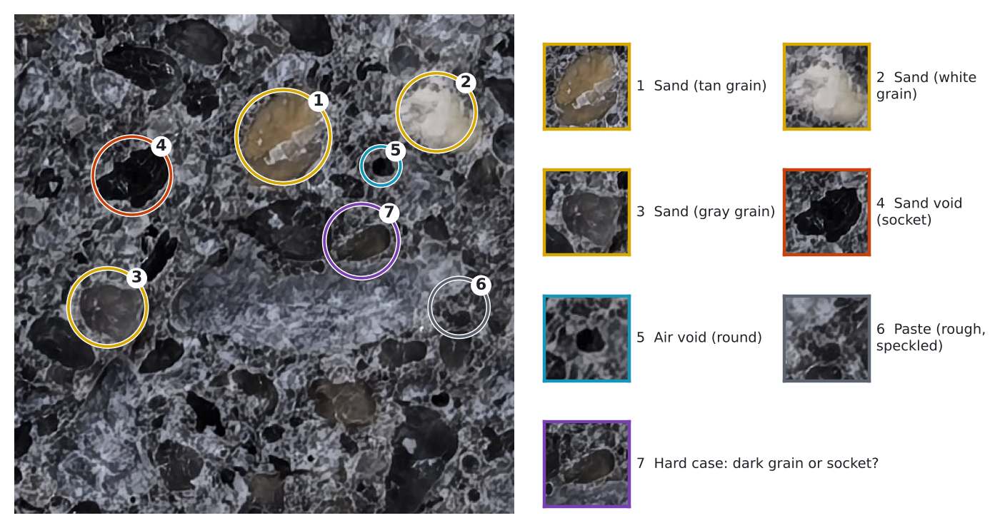

# Labeling Guide: Mortar Fracture-Surface Images

Oct 15, 2026 · Ryan Yu

## Purpose

Hand labels from Dr. Zhao are the ground truth the computer learns from and is graded against, so every labeler must use the same five classes and the same rules. The computer copies whatever the labels say, mistakes included: a consistent label is worth more than a fast one.

The labels serve two jobs:

- **Training:** examples the classifier learns from (where each class looks like what).
- **Testing:** an independent answer key on photos the classifier never saw, giving the accuracy we report.

Targets from the mix design, for checking results: sand about 56% of volume, paste about 30%, and about 4% visible entrapped air (the other ~10% of voids are too small to see without magnification).

## The five classes

Every labeled pixel or point gets exactly one of these five classes. The code is the number the computer reads; the color is only for drawing.

| Code | Class | What it is | How it looks in the photo | Draw color |
| --- | --- | --- | --- | --- |
| 1 | Paste | Hardened cement paste between grains, including its invisible fine pores | Rough, speckled, with a white-gray network texture | Gray (128, 128, 128) |
| 2 | Sand | Any sand grain still in the surface, large or small, any color | Smooth or glassy, rounded outline; tan, brown, olive, gray, white or nearly black | Yellow (255, 230, 0) |
| 3 | Sand void | Socket left where a grain pulled out during fracture | Dark hollow with an irregular or grain-shaped outline; often next to cracked paste | Orange (255, 130, 0) |
| 4 | Air void | Entrapped air bubble from mixing | Round, smooth-walled dish or hole; often lighter inside than a socket | Cyan (0, 200, 255) |
| 5 | Unknown | Anything you cannot call with confidence | Blurry areas, deep shadow, specimen edges, glare | Purple (150, 60, 200) |

Code 0 means "not labeled" and is ignored by the computer. Leaving a pixel unlabeled is always better than guessing.

> Note: these codes match the ilastik export (1 to 5). The automatic pre-label masks in `data/crops/masks/` use an older scheme (0 paste, 1 sand, 2 sand void, 3 air void, 4 unknown, 255 outside); convert before comparing.

Examples on one tile from photo 05 (about 8 mm across). Circle 7 is the hard case: a dark, smooth oval that could be a dark grain or an empty socket.

## Hard cases and rules

When in doubt, use Unknown (5). The rules below cover the cases the computer currently gets wrong.

1. **Dark grain vs. sand void.** A dark grain is solid and often slightly glossy, with a highlight; a socket is a hollow with a shadow on the side toward the light. If the mating half is available, a socket on one half has its grain sticking out at the same spot on the other. If you still cannot tell, use Unknown.
2. **Sand void vs. air void.** Air voids are round and smooth-walled, like a dish. Sockets copy the grain's shape and are usually less regular. A perfectly round socket from a round grain is possible; call it Air void only if the wall looks like smooth paste.
3. **The dark rim around a grain.** The thin shadow line where a grain meets the paste belongs to the grain (Sand), not to Sand void. Draw the grain boundary at the outer edge of the grain.
4. **Grain partly in a socket.** Label the visible grain as Sand and the empty part as Sand void.
5. **Small grains.** Label every grain you can see clearly, however small. Below about 0.2 mm (roughly 10 pixels in current photos) use Unknown rather than guess.
6. **Gray grains.** Gray grains are still Sand. They are smoother and more glassy than paste and have a clear outline.
7. **Blur, glare and deep shadow.** Unknown. Do not label the outer 2 mm of the specimen or any chipped edge.
8. **Cracks in the paste.** Thin cracks are Paste unless wide enough to see an open gap with a floor, then Unknown.

## Three ways to label

Recommended: start with point counting on one tile, then fully paint 3 to 5 tiles. Point counting gives the fastest trustworthy percentages; painted tiles give the computer full shapes to learn from.

| Method | What you do | Time per tile (estimate) | Best for | Tools |
| --- | --- | --- | --- | --- |
| Point counting | Ryan sends a tile with about 150 numbered dots; you write the class of the spot under each dot in a spreadsheet | 15 to 20 min | Testing: an unbiased sand % and accuracy, the same idea as ASTM C457 | Any image viewer + Excel |
| Scribbles | Paint short strokes inside clear examples of each class; the software fills in the rest | 10 to 15 min | Training the current ilastik classifier quickly | ilastik (free) |
| Full paint-over | Color every grain and void outline on a layer over the tile; leave paste unpainted | 45 to 90 min | Training a deep-learning model and the best answer key | GIMP (free), Photoshop, or a tablet paint app |

For the full paint-over: use a separate transparent layer, the exact draw colors from the class table, a hard brush with no smoothing or anti-aliasing, and fill each outline solid. Anything left unpainted counts as Paste.

To check consistency, a second person labels the same tile independently. The agreement between the two labelers is the ceiling the computer can be expected to reach.

## File format and naming

Save labels so the computer can line them up pixel for pixel with the photo. Ryan converts colors to class codes, so you only need to follow these rules:

- **Same size:** the label image has exactly the same width and height as the photo or tile. Do not crop, resize or rotate.
- **Lossless format:** save as PNG (or TIFF), never JPG. JPG blurs colors at the edges and breaks the class codes.
- **Layer only:** export the label layer by itself, with the photo hidden.
- **Name:** the photo name plus `_labels`, for example `01OPC-FoP7C1a_y1536_x1536_labels.png`. Add your initials when two people label the same tile: `..._labels_JZ.png`.
- **Point counting:** one row per dot with columns `point`, `class` (1 to 5), and an optional `note`.

In ilastik, export with Source = Simple Segmentation and Renormalize turned off; that file already uses codes 1 to 5.

## Photo retake checklist

The biggest gains come from sharp focus and even, repeatable lighting, more than from extra megapixels. For every photo:

- [ ] Camera on a fixed stand, lens parallel to the surface, same height for every specimen
- [ ] Phone "AI enhancement", HDR, beauty and auto-sharpen turned off; use Pro or RAW mode if available
- [ ] Fixed exposure, white balance and focus (locked, not auto per shot)
- [ ] Diffuse light from two or more sides, no direct glare or hard shadows
- [ ] Focus checked at the corners and edges, not just the center
- [ ] A ruler or the grid paper in frame, plus a gray card if available, for scale and color
- [ ] Both halves (a and b) shot the same way, the same side up, so they can be lined up
- [ ] Optional: one extra shot per surface lit from a low side angle, to help tell sockets from dark grains
- [ ] File name in the existing pattern, for example `01OPC-FoP7C1a.jpg`, plus the date

Please send original files (no messaging apps, which compress images).

## Data handling and IP

The hand labels are planned as lab IP, so they stay out of public places until UWMRF advises otherwise.

- The project GitHub repository is currently **public**, and it already holds the computer-made tiles and masks for photos 01 to 10. Decision needed: make the repository private, or keep the hand labels in a separate private store (for example a university OneDrive folder).
- Hand labels and new photos go only to the private location, never to the public repository or messaging apps.
- Each label file keeps the labeler's initials and date, so the record of who labeled what is clear.
- Open question for UWMRF: whether the computer-made masks, the trained classifier and the code also count as IP.
